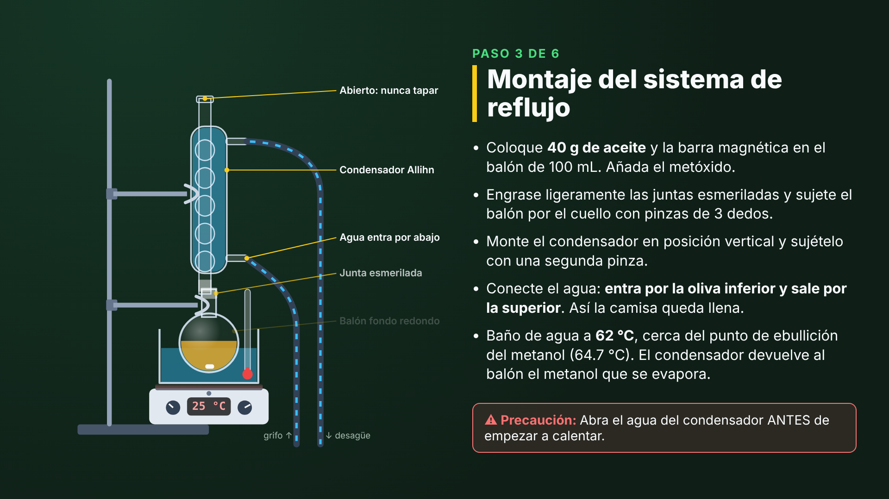
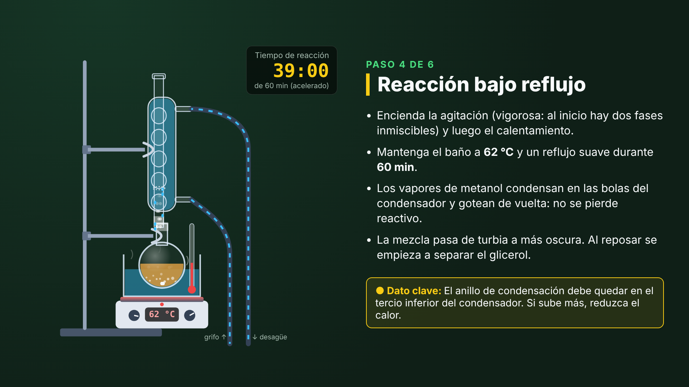
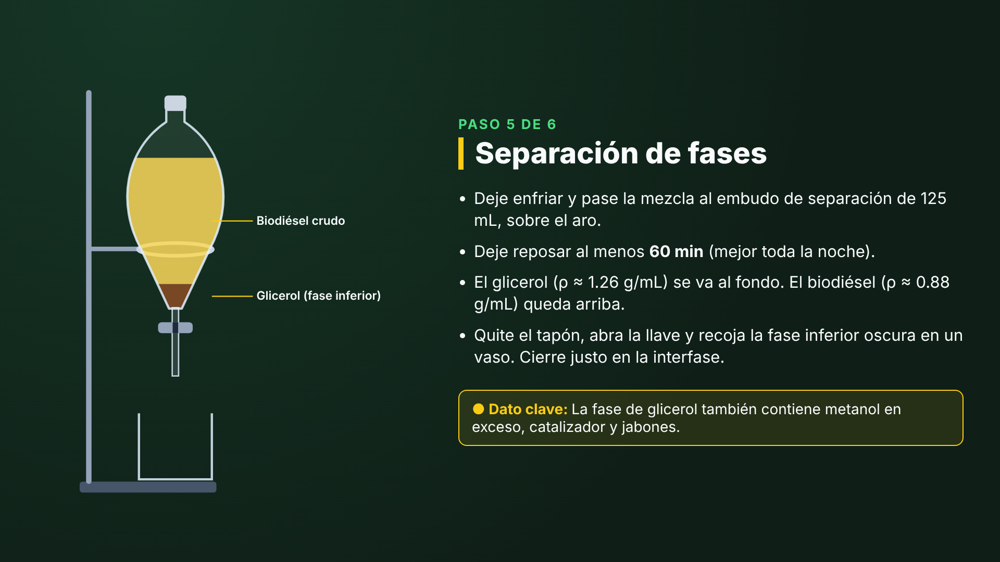

# Biodiésel a partir de aceite de cocina usado — video de práctica con Remotion

Video educativo (1920×1080, 30 fps, 122 s) generado con [Remotion](https://www.remotion.dev). Muestra la síntesis de biodiésel por **transesterificación catalizada por base**, con un **sistema de reflujo** armado con vidriería de un kit de química orgánica Corning (Pyrex®) con juntas esmeriladas.





## Guion

| # | Escena | Duración | Contenido |
|---|---|---|---|
| 1 | Portada | 5 s | Título y curso |
| 2 | Fundamento | 11 s | TG + 3 MeOH ⇌ 3 FAME + glicerol; etapas TG→DG→MG; exceso de metanol (Le Châtelier); jabón por AGL e hidrólisis por agua |
| 3 | Materiales | 10 s | Kit Corning, equipos y reactivos (cantidades calculadas) |
| 4 | Seguridad | 8 s | Metanol, NaOH/metóxido, calentamiento sin llama y en sistema abierto, EPP y residuos |
| 5 | Paso 1 | 11 s | Pretratamiento del aceite, acidez (AGL) y tabla estequiométrica |
| 6 | Paso 2 | 9 s | Preparación del metóxido de sodio (animado) |
| 7 | Paso 3 | 12 s | **Montaje del reflujo** pieza por pieza: soporte, placa y baño, balón, pinza, condensador Allihn, mangueras (el agua entra por abajo) |
| 8 | Paso 4 | 14 s | **Reflujo**: calentamiento, ebullición, vapor que condensa en el tercio inferior del condensador y gotas que regresan; reloj de 60 min |
| 9 | Paso 5 | 12 s | Decantación en el embudo de separación y drenado del glicerol |
| 10 | Paso 6 | 10 s | Lavado con agua tibia y secado con Na₂SO₄ |
| 11 | Resultados | 11 s | Rendimiento; densidad y viscosidad frente a EN 14214 y ASTM D6751 |
| 12 | Referencias | 9 s | Bibliografía |

## Cálculos (`src/quimica/estequiometria.ts`)

Con los datos por defecto: 40 g de aceite, M̄ = 875 g/mol, relación molar MeOH:aceite 6:1, NaOH al 1 % m/m y 0.5 % de AGL.

| Magnitud | Valor |
|---|---|
| Aceite | 0.0457 mol (43.5 mL) |
| Metanol | 0.274 mol = 8.79 g = **11.1 mL** |
| NaOH | 0.40 g (catalizador) + 0.028 g (neutraliza los AGL) = **0.43 g** |
| M̄(FAME) | (875 − 92.09 + 3·32.04)/3 = 293.0 g/mol |
| Biodiésel teórico | **40.18 g** |
| Glicerol teórico | 4.21 g (3.3 mL) |

La mezcla (≈ 55 mL) ocupa ≈ 55 % del balón de 100 mL, por debajo del límite habitual de 2/3.
El rendimiento, la densidad y la viscosidad que se muestran son **valores ilustrativos** (`resultados.ilustrativos: true`): sustitúyalos por las mediciones del grupo.

## Narración (ElevenLabs)

El guion hablado está en `src/narracion.ts`. Hay una pista por escena, con los números escritos en palabras para que la voz los lea bien.
Se generó con la voz **David** (español latinoamericano, uso educativo) y el modelo `eleven_v4`.

1. Descargue las 12 pistas del flujo de ElevenLabs y guárdelas en `public/narracion/` con los nombres indicados en `public/narracion/LEEME.md`.
2. `npm run render`. `calculateMetadata` (`src/tiempos.ts`) mide cada pista y alarga su escena: duración = máx(guion, 0.6 s + voz + 1 s). La voz entra 0.6 s después de iniciar cada escena.
3. Si falta una pista, la escena se renderiza sin voz. Para un video mudo, use `"narracion": false` en las props.

Si cambia la receta, vuelva a generar la pista `05-calculos.mp3`, porque menciona cifras concretas.

## Uso

```bash
npm install
npm run studio     # vista previa y formulario para editar los datos (esquema Zod)
npm run render     # -> out/biodiesel.mp4
npx remotion render src/index.ts ClipReflujo out/reflujo.mp4   # solo el clip del reflujo (14 s)
npx remotion render src/index.ts Biodiesel out/grupo3.mp4 --props=./grupo3.json   # con los datos de un grupo
```

`grupo3.json` debe tener la forma de `src/props-por-defecto.ts`. Por ejemplo, para cambiar solo los resultados, copie ese objeto y edite `resultados`.
Si no hay acceso a internet para descargar Chrome Headless Shell, agregue `--browser-executable=/ruta/a/chromium`.
El render completo tardó ≈ 4.5 min en un contenedor de 4 núcleos.

## Estructura

```
src/
├── Root.tsx                 # Composiciones: Biodiesel (completo) y ClipReflujo
├── Video.tsx                # Orden de escenas con <Series>
├── tema.ts                  # Colores y guion (duración de cada escena)
├── schema.ts                # Esquema Zod de las props
├── props-por-defecto.ts     # Receta, condiciones y resultados
├── quimica/estequiometria.ts
├── lab/                     # Material de laboratorio en SVG animado
│   ├── Reflujo.tsx          # Soporte, placa, baño, balón, condensador Allihn, mangueras, vapor
│   ├── Embudo.tsx           # Embudo de separación con capas y drenado
│   └── Erlenmeyer.tsx       # Preparación del metóxido
├── ui/                      # Escena, plantilla de "Paso", fórmulas con sub/superíndices
└── escenas/                 # Una escena por archivo
```

## Referencias

- Freedman, B., Pryde, E. H. y Mounts, T. L. (1984). Variables affecting the yields of fatty esters from transesterified vegetable oils. *J. Am. Oil Chem. Soc.*, 61(10), 1638–1643.
- Ma, F. y Hanna, M. A. (1999). Biodiesel production: a review. *Bioresource Technology*, 70(1), 1–15.
- Canakci, M. y Van Gerpen, J. (2001). Biodiesel production from oils and fats with high free fatty acids. *Transactions of the ASAE*, 44(6), 1429–1436.
- Meher, L. C., Vidya Sagar, D. y Naik, S. N. (2006). Technical aspects of biodiesel production by transesterification—a review. *Renew. Sustain. Energy Rev.*, 10(3), 248–268.
- Knothe, G., Krahl, J. y Van Gerpen, J. (eds.) (2010). *The Biodiesel Handbook* (2.ª ed.). AOCS Press.
- ASTM D6751, *Standard Specification for Biodiesel Fuel Blend Stock (B100) for Middle Distillate Fuels*; EN 14214, *Fatty acid methyl esters (FAME) for diesel engines*.
- AOCS Official Method Ca 5a-40 (ácidos grasos libres). PubChem: Methanol (CID 887); Sodium hydroxide (CID 14798).

Las normas se actualizan periódicamente. Verifique los límites en la edición vigente antes de usarlos para evaluar.
