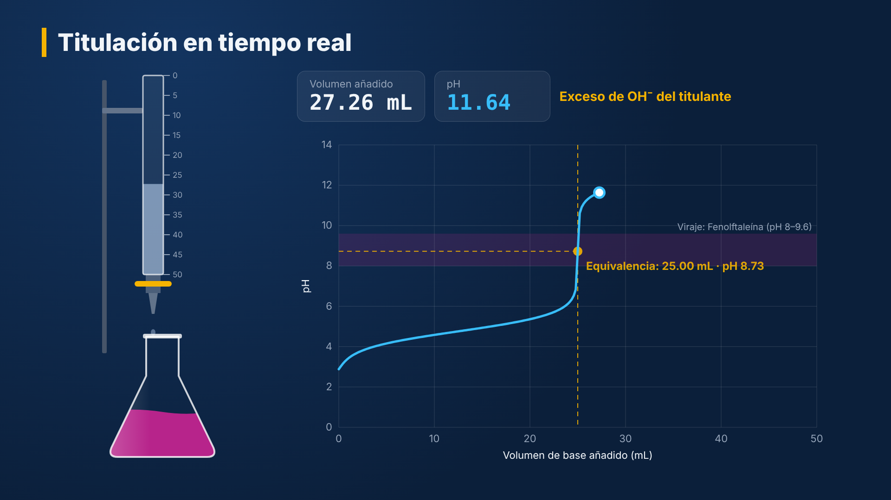
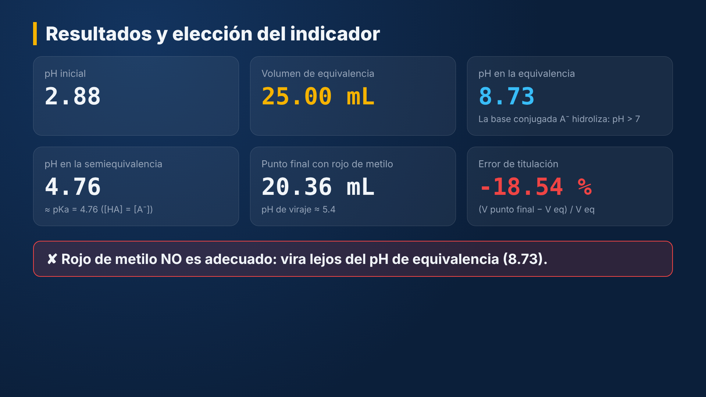

# Titulación ácido-base con Remotion

Proyecto de ejemplo completo de [Remotion](https://www.remotion.dev): **videos educativos generados con código (React + TypeScript) a partir de datos**.
Cada video muestra una titulación ácido monoprótico + NaOH con:

1. **Introducción** animada (resortes, interpolaciones).
2. **Reacción y datos**: ecuación iónica neta con subíndices/superíndices y cálculo de V<sub>eq</sub>.
3. **Titulación en tiempo real**: bureta que gotea, matraz cuyo color cambia según el indicador, curva de pH que se dibuja punto a punto.
4. **Resultados**: pH inicial, V<sub>eq</sub>, pH de equivalencia, pH de semiequivalencia (≈ pK<sub>a</sub>), punto final del indicador y **error de titulación**, con veredicto sobre la elección del indicador.
5. **Referencias**.




## Fundamento químico

La curva **no** se aproxima por tramos (Henderson-Hasselbalch, etc.): se resuelve en cada punto el **balance de carga exacto**

[H⁺] + [Na⁺] = [OH⁻] + [A⁻]

con [A⁻] = C<sub>HA</sub>·K<sub>a</sub>/(K<sub>a</sub> + [H⁺]) y K<sub>w</sub> = 1,0 × 10⁻¹⁴ (25 °C), por bisección sobre log[H⁺] (`src/chem/titulacion.ts`).
Un ácido fuerte se modela con K<sub>a</sub> → ∞. Se desprecian los coeficientes de actividad (se usan concentraciones).

Valores de control (CH₃COOH 0,1000 M, 25,00 mL; NaOH 0,1000 M; K<sub>a</sub> = 1,75 × 10⁻⁵):

| Magnitud | Calculado | Valor de texto |
|---|---|---|
| pH inicial | 2,88 | 2,88 |
| pH en la semiequivalencia | 4,76 | pK<sub>a</sub> = 4,76 |
| pH en la equivalencia | 8,73 | 8,72–8,73 |

Intervalos de viraje de los indicadores: fenolftaleína 8,0–9,6; rojo de metilo 4,8–6,0; azul de bromotimol 6,0–7,6 (Harris, tabla de indicadores ácido-base).
El "punto final" se toma en el pK del indicador (centro del intervalo); el error de titulación es (V<sub>pf</sub> − V<sub>eq</sub>)/V<sub>eq</sub>.

**Referencias**

- Harris, D. C. (2015). *Quantitative Chemical Analysis* (9.ª ed.). W. H. Freeman. Capítulos de tratamiento sistemático del equilibrio y titulaciones ácido-base.
- Skoog, D. A., West, D. M., Holler, F. J. y Crouch, S. R. (2015). *Fundamentos de Química Analítica* (9.ª ed.). Cengage Learning.
- IUPAC Gold Book: *titration*, *equivalence point*, *end point* — https://goldbook.iupac.org
- Documentación de Remotion — https://www.remotion.dev/docs

## Requisitos

- Node.js ≥ 18 (probado con Node 22) y npm.
- Linux, macOS o Windows. En un VPS Linux, Remotion descarga *Chrome Headless Shell* la primera vez. Si falta alguna biblioteca del sistema, consulte https://www.remotion.dev/docs/miscellaneous/linux-dependencies (en Ubuntu/Debian: `libnss3 libdbus-1-3 libatk1.0-0 libgbm-dev libasound2 libxrandr2 libxkbcommon-dev libxfixes3 libxcomposite1 libxdamage1 libatk-bridge2.0-0 libpango-1.0-0 libcairo2 libcups2`).

## Uso

```bash
npm install

# Editor visual en el navegador (http://localhost:3000): vista previa, línea de tiempo
# y un formulario generado desde el esquema Zod para cambiar los datos en vivo.
npm run studio

# Renderizar el video con los datos por defecto -> out/titulacion.mp4
npm run render

# Renderizar con otros datos (archivo JSON con la forma de src/schema.ts)
npx remotion render src/index.ts Titulacion out/mio.mp4 --props=./mis-datos.json

# Imagen fija (PNG) con los resultados
npx remotion still src/index.ts Miniatura out/miniatura.png

# Lote: un MP4 por cada experimento de data/experimentos.json
npm run lote                      # API de Node (@remotion/renderer)
python3 scripts/render_lote.py    # misma tarea desde Python (CLI vía subprocess)
```

Si ya tiene Chrome/Chromium instalado y no desea la descarga automática, agregue
`--browser-executable=/ruta/a/chrome` a la CLI, o defina `BROWSER_EXECUTABLE` para `npm run lote`.

Un video de 39 s a 1920×1080 y 30 fps pesa aproximadamente 3,6 MB (H.264, CRF 18).

## Agregar un experimento

Añada un objeto a `data/experimentos.json`:

```json
{
  "id": "acido-formico",
  "props": {
    "institucion": "Departamento de Química",
    "curso": "Química Analítica I",
    "titulo": "Titulación de ácido fórmico",
    "autor": "Prof. …",
    "acido": {"nombre": "Ácido fórmico", "formula": "HCOOH", "concentracion": 0.05, "volumen": 20, "ka": 1.8e-4},
    "base":  {"nombre": "Hidróxido de sodio", "formula": "NaOH", "concentracion": 0.1},
    "ecuacionNeta": "HCOOH(ac) + OH^-(ac) → HCOO^-(ac) + H2O(l)",
    "indicador": "fenolftaleina",
    "duracionTitulacionSeg": 12
  }
}
```

- `ka: null` indica un ácido fuerte.
- En `formula` y `ecuacionNeta`, los dígitos que siguen a una letra o paréntesis se muestran como subíndice, y `^-`, `^+`, `^2-` como superíndice.
- La duración total del video se recalcula sola (`calculateMetadata` en `src/Root.tsx`).

## Estructura

```
remotion-titulacion/
├── data/experimentos.json      # Datos de entrada (un video por entrada)
├── remotion.config.ts          # Configuración de la CLI (códec, calidad)
├── scripts/
│   ├── render-lote.mjs         # Render por lotes con la API de Node
│   └── render_lote.py          # Render por lotes desde Python
└── src/
    ├── index.ts                # registerRoot()
    ├── Root.tsx                # <Composition> y <Still> registradas
    ├── schema.ts               # Esquema Zod de las props (valida y genera el formulario)
    ├── theme.ts                # Colores, tipografía, duración de escenas
    ├── Titulacion.tsx          # Encadena las escenas con <Series>
    ├── chem/titulacion.ts      # Modelo químico (balance de carga, indicadores)
    ├── components/             # Bureta, Matraz, CurvaPH, Formula, Escena
    └── scenes/                 # Intro, Reaccion, Experimento, Resultados, Referencias
```

## Conceptos de Remotion que ilustra

| Concepto | Dónde |
|---|---|
| `useCurrentFrame`, `interpolate`, `Easing` | `scenes/Experimento.tsx` (ritmo de adición más lento cerca de la equivalencia) |
| `spring` | `scenes/Intro.tsx` |
| `<Series>` / `<Series.Sequence>` | `Titulacion.tsx` |
| Props tipadas con Zod + `calculateMetadata` | `schema.ts`, `Root.tsx` |
| `<Still>` (imágenes fijas) | `Root.tsx` → `Miniatura` |
| SVG animado | `components/Bureta.tsx`, `Matraz.tsx`, `CurvaPH.tsx` |
| Render programático (SSR) | `scripts/render-lote.mjs` |

## Despliegue en un VPS

1. Instale Node.js LTS (p. ej. con `nvm`) y las dependencias del sistema indicadas arriba.
2. `git clone …` y `npm ci` en la carpeta del proyecto.
3. Ejecute `npm run lote` o llame a `scripts/render_lote.py` desde cron o desde su backend (PHP: `exec('cd /ruta && npx remotion render … --props=/tmp/x.json')`).
4. Renderizar consume mucha CPU. Limite la concurrencia (`--concurrency=2` o `CONCURRENCY=2`) si el VPS atiende otros servicios.

## Licencia de Remotion

Remotion se distribuye bajo la *Remotion License*. El uso es gratuito para personas, organizaciones sin fines de lucro y empresas de hasta 3 empleados. Otros casos requieren una *Company License*.
Antes de cualquier uso institucional, consulte https://www.remotion.dev/license.
